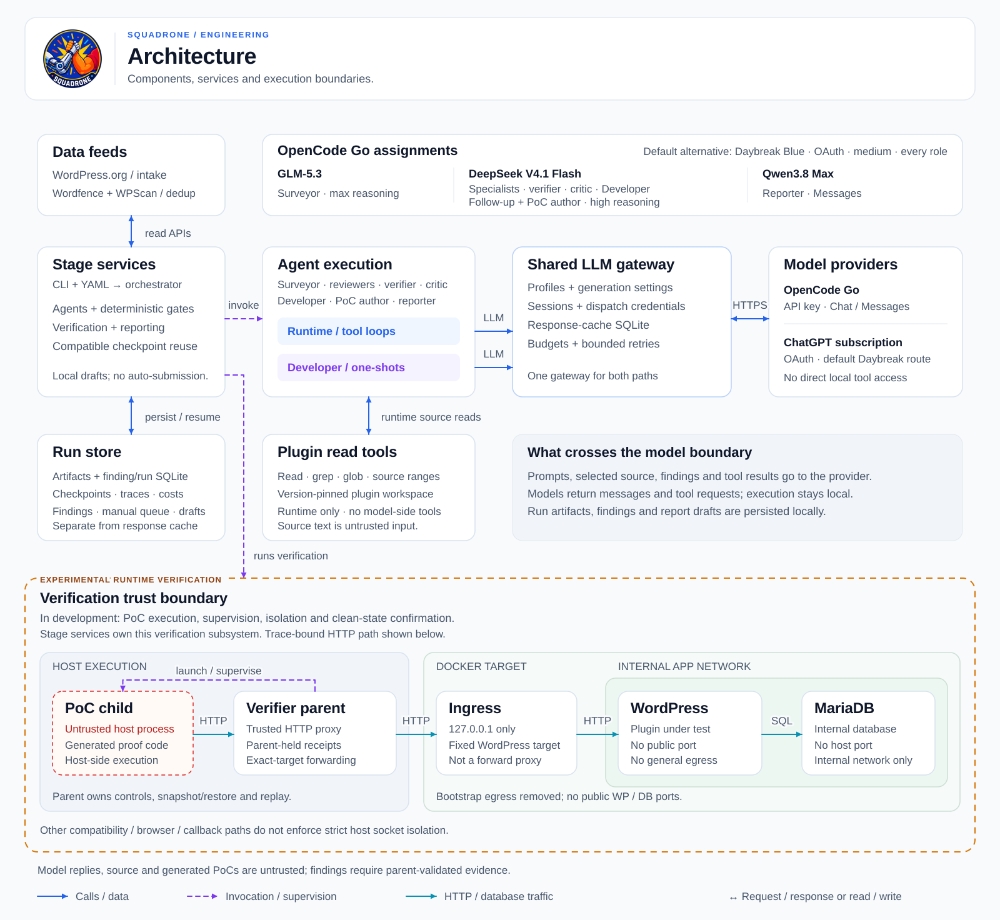
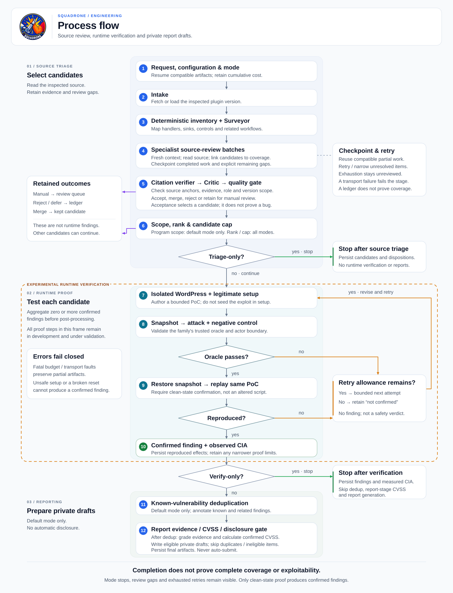

# Squadrone Design

## Objective

Squadrone is an automated WordPress plugin vulnerability research pipeline. Its
success condition is not a suspicious code pattern. It is a source-grounded,
clean-state reproduced vulnerability with a concrete confidentiality,
integrity, or availability impact and a realistic CVE disclosure route.

The design optimizes for:

1. Broad review of shipped attack surface.
2. Low false-positive output.
3. Minimal human intervention before final disclosure review.
4. Explicit artifacts for every consequential decision.
5. A small fixed methodology instead of combinatorial feature modes.

Squadrone does not auto-submit reports, test remote production systems, or
claim that a pattern, HTTP status, reflection, or blind callback is itself a
vulnerability.

## Architecture Overview



The component diagram separates orchestration, agent execution, the shared LLM
gateway, persistence, external services, and the local verification boundary.
It shows the selected Go model assignments alongside the unchanged Daybreak
alternative. The sandbox detail depicts the trace-bound HTTP proof path, not
universal host-process isolation.

## Pipeline



The flow diagram shows execution order, mode-specific stops, triage outcomes,
bounded retries, and the clean-state confirmation required before a finding.

This is the default disclosure scan. `--triage-only` disables disclosure-program
scope filtering and stops after technical triage, before runtime verification.
`--verify-only` also disables that filtering, verifies candidates, and skips
known-vulnerability deduplication and report generation. An accepted triage
candidate is not a reproduced vulnerability; a completed triage-only run may
also retain manual-review items and unresolved source-coverage gaps.

### 1. Intake

Intake obtains the latest WordPress.org release unless a version is explicitly
pinned. Latest releases use the official plugin ZIP. Pinned historical releases
use the matching SVN tag when available and fall back to the official versioned
ZIP when SVN or the tag is unavailable. Latest-version scans reject components
that WordPress.org reports as closed.

Output: `intake.json`.

### 2. Coverage And Threat Mapping

`services/coverage.py` deterministically enumerates production PHP,
JavaScript, TypeScript, template, distribution, and build files. It excludes
tests, examples, documentation, language packs, VCS metadata, and
`node_modules`. Bundled dependencies are listed separately and remain readable
when a plugin call path enters them.

The inventory includes:

- AJAX, REST, admin-post/form, shortcode, block, WooCommerce AJAX/API, webhook,
  and selected request-lifecycle callbacks
- SQL, command, HTTP, XML, deserialization, and file operations
- option/object writes used as persistent-input lifecycle anchors
- authentication state and role/capability changes
- DOM HTML and JavaScript execution sinks in built frontend code

Generic reads and output calls are not independent ledger items. Callback
registrations are assigned to both authorization and XSS workflow review, and
reviewers follow reads/renders within the owning callback or persistence
lifecycle; enumerating
every `get_option()`, metadata read, and `echo` previously created hundreds of
shallow tasks without representing additional security boundaries.

The Surveyor validates and enriches this minimum inventory, resolves dynamic
registrations, follows handlers/helpers, and produces the plugin threat map:
sensitive objects, roles, capabilities, workflows, and persistent write/read
lifecycles.

Deterministic inventory survives the merge; Surveyor discoveries can add review
targets. Neither the inventory nor a model-generated call edge proves external
reachability. Internal lifecycle hooks are not additional public HTTP routes,
and a nonce/capability presence flag does not prove that the check dominates
every branch. UI role labels must be distinguished from enforced controls.

Outputs: `recon.json` and initial `coverage.json`.

### 3. Source Review

Four review areas own distinct security questions and are all enabled in the
shipped pipeline. Configuration may select a non-empty subset or restrict the
coverage-item types reviewed for focused and regression work. One workflow can
be assigned to more than one enabled reviewer when it crosses those questions:

| Review area | Responsibility |
|---|---|
| `authorization_workflows` | Object ownership, capabilities, state transitions, protected options/content/files, CSRF outcomes, mass assignment |
| `injection_files` | SQL/command injection, traversal, file operations, SSRF impact, XML, deserialization and gadgets |
| `xss_lifecycle` | Reflected callback-to-render paths, attacker write/persistence/render lifecycles, victim path, built JS, browser execution |
| `authentication` | Login/session state, recovery, magic links, token lifecycle, practical crypto/randomness bypass |

Each reviewer gets source-local batches of at most a bounded number of coverage
items and a compact recon view containing only related entry points, sinks, and
call edges. Every batch starts with a fresh model context while unrestricted
range-aware source tools remain available. This prevents the full recon and old
tool history from being resent on every turn.

For each item the reviewer must return `candidate`, `reviewed`, `unreachable`,
or `unreviewed`. Every completed `candidate`, `reviewed`, or `unreachable`
disposition cites the assigned `file:line` from an actual source-tool read, and
every candidate links to an emitted hypothesis. Deterministic targets retain
their match column, and minified-line targets count as read only when the tool
window includes that column. Runner-generated terminal `unreviewed` gaps remain
anchored to the assigned location but do not claim a successful source read.

An incomplete disposition receives up to four bounded, progressively narrowed
attempts. If work remains unresolved, Squadrone records explicit `unreviewed`
gaps and a reusable `exhausted` checkpoint; it does not treat those items as
covered or discard the completed work from a large batch. A reviewer transport
or runtime failure still fails the stage.

A hypothesis must include the exact sink expression and location, lowest
attacker role, source-to-outcome path, closest control, security boundary,
counterevidence, narrow runtime proof gap, and plain CIA consequence.

The inspected version comes from `intake.json`, not the model's recollection of
release history. Source review must distinguish known plugin facts, qualified
WordPress core contracts, and unverified save/filter/render prerequisites.
Source tools are plugin-scoped; an ordinary one-shot Developer consultation has
no independent WordPress-core reader or running WordPress instance. A completed
consultation is advice, not a verified source citation or runtime observation.

Outputs: `review_batches/<area>/`, `hypotheses_<area>.jsonl`,
`coverage_<area>.json`, updated `coverage.json`, and `hypotheses.jsonl`.

### 4. Verification And Critic Review

The narrowly scoped hypothesis verifier has one job: reject a fabricated
citation or a contradiction visible in the cited source window. It does not
attempt a second, partial vulnerability methodology.
It first checks the source quote, tolerating whitespace and a uniquely matching
nearby citation within its bounded line window. Keeping a hypothesis means its
local citation survived this check, not that every prerequisite was proved.

The Critic can read any plugin file. It re-derives complete callbacks and
helpers, attempts to disprove every claim, checks default configuration and the
lowest role, and decides technical validity without considering bounty scope.

The deterministic quality gate then requires:

- an exact file, line, and sink quote
- an explicit attacker source and reachable path
- a real security boundary
- at least one concrete CIA dimension
- no cosmetic-only or unsafe-configuration-only claim

A dangerous primitive alone is insufficient: its family contract determines the
protected effect and evidence required for an automatic finding.

Triage also checks explicit attacker-role prerequisites against the structured
role and limits affected-version claims to the inspected version. When no other
disqualifying rule applies, unknown/conflicting role metadata and unsupported
historical version claims are retained unchanged in `manual_review`, rather than
silently assigned a lower role or narrowed to another version. Other invalid
evidence can still cause rejection.
The role parser is a conservative text-consistency check, not a capability or
plugin-intent oracle. The Critic may not rewrite the raw attacker role,
preconditions, or affected-version claim to make an acceptance pass.

Family-specific evidence contracts additionally separate source-valid paths
that the automatic verifier can represent from those needing manual review.
The Critic can make a same-file, bounded source-anchor correction only with
explicit repair metadata and preserved claim invariants. Merge decisions must
retain genuine source/actor/outcome equivalence; a shared dangerous sink alone
is not enough.

No CVSS number is guessed before runtime proof. Pre-verification severity is
only an unscored priority used for ranking. Source reads, valid JSON, a complete
coverage ledger, and model agreement do not establish exploitability or prove
that intended PHP/HTML authoring crosses a security boundary.

### 5. Scope And Ranking

Program eligibility is separate from technical validity. Current
Wordfence/Patchstack rules route eligible candidates; valid but ineligible
items are `deferred`. This prevents program policy from being mislabeled as a
source-code false positive.

The route evaluates vulnerability type, attacker role, and impact. It assumes
the target was selected using `plugin_selection_scope.md`; install count,
vendor exclusions, researcher tier, and Patchstack mVDP enrollment are asset
metadata and are not inferred from plugin source.

Ranking happens after technical quality and scope filtering. It prioritizes
lower attacker privilege, greater demonstrated CIA impact, fewer
configuration preconditions, and stronger source confidence. Only then is
`max_hypotheses_to_verify` applied. Candidates below the cap are also deferred.

Output: `triaged.json`, `triaged.jsonl`, and `quality_gate_triage.json`.

### 6. Sandbox Proof

The verifier installs the unmodified plugin in an isolated WordPress/MariaDB
Docker stack and creates baseline WordPress roles. The Developer proposes only
legitimate prerequisite setup. Setup that directly seeds an exploit payload
into storage invalidates the proof.

The stack uses three distinct network roles. MariaDB is attached only to the
internal application network. WordPress temporarily also joins a per-sandbox
bootstrap network while WordPress and its tooling are installed, then Squadrone
disconnects it and removes that network before exposing the verifier API. A
trusted ingress sidecar spans the internal application network and a separate
ingress network. Its normal HTTP listener proxies only to the fixed WordPress
service and is published only on `127.0.0.1`. After sealing, Squadrone inspects
both Docker network flags, all three containers' exact network memberships, and
every published-port binding. WordPress persists the internal network as its
primary Docker network while the bootstrap network owns only the temporary
installation-time default route; sealing attests that persistent mode so a
clean-state container restart cannot reference the removed network. A
disconnect, removal, inspection, or topology mismatch fails the boot and
triggers partial-project cleanup.

Every PoC emits one structured observation:

```json
{
  "schema_version": 1,
  "verdict": "vulnerable",
  "oracle": "response_marker",
  "attacker_role": "subscriber",
  "request": {"method": "POST", "url": "http://localhost/..."},
  "attack": {"observed": true},
  "control": {"observed": false},
  "impact": {
    "confidentiality": "high",
    "integrity": "none",
    "availability": "none",
    "description": "..."
  }
}
```

The sandbox validates class-specific fields rather than searching stdout for a
success word:

| Oracle | Minimum evidence |
|---|---|
| `timing` | At least three attack/control samples and a material median differential |
| `response_marker` | Unique private marker in attack and absent from control |
| `state_change` | Different before/after state only for attack |
| `authorization` | Protected effect allowed for attack and denied for control |
| `cross_object_access` | Runner-traced HTTP requests with server-signed WordPress identities; measured protection path; bound objects, provenance, dispatch, and matching parameter shapes; separate markers and a legitimate control; trusted before/after evidence for writes |
| `callback` | Attack-only callback carrying a unique sensitive marker |
| `browser_execution` | JavaScript execution for attack and not control |
| `file_effect` | Observed path plus SHA-256 marker, absent for control |

This table is not a universal acceptance matrix. The
[taxonomy registry](src/squadrone/schemas/taxonomy.py) selects family-specific
contracts and supported oracles; unreviewed CWE families remain manual-only.
Selected execution, PHP-include, object-injection and executable-upload paths
require additional parent-owned request/effect attestations. A child-generated
observation cannot substitute for those receipts. Stored SQL injection has a
narrower automatic timing-only contract with a bound writer, storage identity
and later trigger; an inert object-instantiation receipt alone does not prove a
usable deserialization gadget or full compromise.

The cross-object HTTP proof path is supervised by a parent-owned, exact-origin proxy.
The child receives only the proxy address; request nonces, trace salts, and the
sandbox receipt secret remain in the parent. For cross-object claims, every
proof request is bound to its exact method, target, body digest, server-signed
WordPress identity, parsed parameter shape, and an uninterrupted
protection/before/attack/after/control sequence. Opaque bodies, hidden routing
overrides, raw marker reflection, failed forwarding, and incomplete capture all
fail closed.

SSRF response proofs use the same parent proxy with one of two verifier-owned
oracles. Network-fetch claims use a short-lived HTTP service outside the
WordPress container: its private marker, generation, and hit ledger never enter
the plugin trust domain, and each inner hit must fall inside its matching outer
request. The sealed WordPress container reaches that service only through a
temporary fixed-path relay in the trusted ingress. The relay has one unexposed
listener matching the current parent oracle port, denies every other path, and
maps only `/_squadrone/ssrf/` to that exact host-gateway port; it is not a
forward proxy. Its configuration is staged, syntax-checked, activated, and
probed from WordPress before use. Rotation disables the prior relay before its
parent listener closes, and readiness or relay-mutation failure fails closed;
teardown follows the same relay-before-listener ordering.

Local-resource scheme-bypass claims instead use an opaque canary file outside
the web root, supplied through an exact read-only bind mount. The parent
withholds the fresh marker, attests the mount and immutable file before and
after execution, confines the opaque path capability to the two destination
fields, and restarts WordPress request workers before clean-state confirmation.
In both modes the cited method, route, dispatch, destination field, request
values, headers, actor boundary, and confirmation are bound exactly. Alternate
self-reported SSRF oracles fail closed.

Trace-bound HTTP PoCs additionally run in a bounded macOS Seatbelt profile. It
can read only the copied PoC bundle and derived Python/runtime dependencies,
write only inside the bundle, and connect only to the parent proxy port. The
profile denies host credential paths, process inspection/spawning, Unix
sockets, and all other TCP destinations. PoCs outside that trace-bound path use
the host-side compatibility runner with a filtered environment but without a
strict socket policy. The Docker target remains network-sealed, but the
compatibility process itself is not an external-egress boundary. Browser and
inbound-callback oracles retain this path until dedicated capability profiles
are added; they are never accepted as cross-object evidence.

Before each attempt, Squadrone snapshots the full database and complete
`/var/www/html` volume, including hidden and root-level WordPress files. Trusted
oracle mounts under `/var/lib/squadrone` remain outside that archive by design.
After an oracle passes, Squadrone strictly restores the snapshot and runs the
exact same script again. Snapshot/restore errors fail closed. Only a successful
confirmation creates a `Finding`; historical `partial` values remain parseable
but are never accepted.

Output: `verifications/<hypothesis_id>/` and `findings.jsonl`.

### 7. Scoring, Deduplication, And Reports

Deduplication checks Wordfence Intelligence and, when `WPSCAN_API_KEY` is set,
WPScan, and distinguishes exact known paths from potentially related issues.
The report stage then calculates CVSS v3.1 base metrics from confirmed attacker
role, interaction/scope semantics, and CIA dimensions, storing the vector and
score in the finding. This happens before its report-evidence, known-duplicate,
and current-program eligibility checks. `--verify-only` skips deduplication and
reporting, so a confirmed finding can remain unscored in that mode.
Reports are generated only for a confirmed, evidence-complete, non-duplicate
finding that still meets the target program's current rules.

Outputs: updated `findings.jsonl` and
`report_<finding_id>_<program>.md`.

## Configuration Surface

Pipeline YAML contains operational controls:

- role models, global generation controls, and per-role reasoning overrides
- optional named model profiles with explicit route, protocol, credential-variable
  name, generation/history limits, and token-price estimates
- cost ceiling and candidate cap
- verification iterations and timeouts
- developer consultation cap
- Docker image/account settings
- persistent sandbox reuse, failure diagnostics, and screenshots
- optional reviewer-area and coverage-item selection

Vulnerability-database endpoints, source tools, technical quality gates,
negative controls, clean confirmation, scope routing, and report grading are
fixed behavior. Wordfence and WPScan credentials are supplied through the
environment rather than pipeline YAML.

For legacy LiteLLM model strings, `llm.reasoning_effort` is the global default.
For `profile/<name>` routes, profile generation defaults are overlaid by global
controls and then non-null `reasoning.<role>` overrides. Unsupported efforts or
protocol-specific settings fail validation/resolution instead of being silently
dropped. All four focused review areas map to the single `specialists` slot;
the configuration does not choose a different model for each specialist.

### Model Routing And Conversation State

Two operational pipelines are shipped. [pipelines/chatgpt.yaml](pipelines/chatgpt.yaml)
uses provisioned ChatGPT-subscription access and
`chatgpt/gpt-daybreak-blue-latest` for every role with `medium` reasoning.
[pipelines/opencode-go.yaml](pipelines/opencode-go.yaml) explicitly selects:

| Roles | Model | Profile API / generation |
|---|---|---|
| Surveyor | `glm-5.3` | OpenAI-compatible Chat; `max` reasoning; 32,768 output-token cap |
| Four specialists, citation verifier, Critic, Developer, Developer follow-up, PoC author | `deepseek-v4.1-flash` | OpenAI-compatible Chat; `high` reasoning; 16,384 allowance floor, 32,768 cap |
| Reporter | `qwen3.8-max` | Anthropic-compatible Messages; 16,384 output-token cap |

These are configured choices, not a measured claim that each is optimal for its
role. Squadrone does not automatically change models, reduce reasoning effort,
or switch protocols when a provider refuses a request.

`AgentRuntime` owns tool dispatch and trace records; `LiteLLMTransport` owns the
bounded conversation loop; `services/llm.py` is the shared cache, connection,
retry and budget gateway. `services/model_profiles.py` resolves either a legacy
LiteLLM model string or a validated named profile before dispatch. Profiles use
explicit HTTPS endpoints and name an environment variable instead of embedding
a key. Credential values and connection headers are injected after cache lookup,
not into the semantic model identity or request cache key. Profile Chat routes
reject ambiguous ambient OpenAI custom/organization/project headers rather than
inherit them. Legacy provider/OAuth routing remains with LiteLLM.

Each agent invocation gets a conversation ID. The same ID spans ordinary tool
turns, forced finalization, schema repair and bounded one-shot retries; nested
Developer invocations get a separate ID with parent context. Caller-side
`developer_call` records do not expose every helper's separate request ID.
OpenCode profile requests send `User-Agent: squadrone/0.1.0` and that stable
`x-opencode-session` value. Resume starts new invocations rather than continuing
an interrupted provider-side conversation.

Assistant history retains reasoning, signatures, tool-call IDs and provider
fields. The shipped Go profiles use `history_policy: preserve`; profiles can
explicitly opt into `trim`, and legacy routes retain bounded whole-tool-cycle
trimming. An optional estimated input-token limit rejects oversized preserved
requests without silently dropping evidence; otherwise provider context limits
still apply. For the selected DeepSeek route, a tool-calling assistant turn with
missing/null `reasoning_content` receives an explicit empty string. Existing
reasoning is preserved; no reasoning text is invented. This wire-compatibility
choice is traced separately from semantic model identity.

### Output Validation And Failure Handling

Output-token allowances include provider reasoning as well as the visible
answer. The DeepSeek profile's floor applies even to short Developer helpers;
it is a request allowance, not a minimum answer length or an accuracy guarantee.
A one-shot request with an incomplete answer may retry once at its profile cap
when that is larger than the initial allowance. Refusals and filtering do not
trigger this larger-allowance retry; legacy routes without a profile cap have
no allowance expansion. A setup helper can separately request one JSON-shape
repair, so those two one-shot calls can consume up to four budgeted generations
when expansion is available. Empty/reasoning-only final answers and
length-limited output are not treated as completed advice, setup or schema
results. Complete tool-only turns remain valid inside the agent loop; an
incomplete loop turn fails instead of automatically restarting that agent.

The shared gateway makes bounded retries for classified transient transport,
rate-limit and service failures. Authentication, unsupported-request and other
non-retryable errors propagate. Agent loops have their own iteration and tool
budgets, forced-finalization policy and schema-repair handling. Source-coverage
retries are separate: completed work is checkpointed, while missing or invalid
candidate links remain unresolved rather than counted as reviewed.

An incomplete Developer consultation returns an explicit unavailable,
non-authoritative tool result; it is not expert agreement or evidence against a
hypothesis. Consultations can still be factually wrong when complete, so callers
must retain source checks and precise unresolved prerequisites.

### Runtime And Distribution

A bounded in-process compatibility layer registers explicit newer ChatGPT
aliases when LiteLLM does not yet know them, maps them to GPT-5 generation
controls, and repairs incomplete streamed Responses aggregation. The current
allowlist is `chatgpt/gpt-5.5`, `chatgpt/gpt-5.6-sol`, and
`chatgpt/gpt-daybreak-blue-latest`; unrelated future aliases are not patched
implicitly. Native LiteLLM support remains authoritative when present.

The supported runtime is CPython 3.12; Python 3.13 is excluded. Direct,
development, and build dependencies are exactly pinned.
`requirements/constraints.txt` pins the full resolved graph, and LiteLLM stays
on the adapter-compatible release until the
compatibility layer is no longer required.

Compose, WordPress initialization, and actor-receipt templates are installed as
`squadrone.docker` package resources so wheel installations do not depend on the
repository working directory. The root `docker/` files are compatibility
mirrors and must remain byte-identical to the packaged copies. The shipped
pipelines also pin the WordPress and MariaDB images by digest.

### Response Cache And Estimated Budgets

The SQLite response cache hashes the resolved route/model, prepared messages,
tool definitions, effective non-secret settings and output allowance. Session
IDs, credential-variable names, credential values and prices are not semantic
cache identity. A cache hit avoids a provider request and new budget charge;
it does not establish correctness or replace final-response validation. This
cache is not an account or tenant isolation boundary. Traces and cached model
responses can contain source, tool results and provider reasoning, so they are
sensitive research artifacts even when connection credentials are excluded.

The LLM budget is reserved conservatively before uncached calls. Completed
responses are accounted for and returned before another call can be rejected,
so a ceiling does not discard an already-completed batch result. Profile pricing
separates uncached input, cache reads, cache writes and output; normalized
provider counts are reconciled without counting cached input twice. Legacy
routes without explicit prices retain fallback estimates. Dollar values are
internal scheduling estimates, not subscription charges, Go quota balances or
proof that a provider will permit the next request. Provider usage windows,
rate limits and access rules are enforced independently.

On resume, prior `cost_calls.tsv` rows are restored before new calls. Earlier
and resumed work share one cumulative ceiling, including stages repeated with
`--from`. Malformed, negative, non-finite, or already-over-ceiling restored data
fails closed. Batch scans create a separate ceiling for each plugin.

The public scan flags are:

```text
scan:       --config --budget --version --resume --from --verify-only --triage-only --verbose
scan-batch: --concurrency --config --budget --version --verify-only --triage-only --verbose
```

## Benchmark Semantics

Every corpus item is a vulnerable/fixed version pair. Metrics distinguish:

- hypothesis recall at 1/3/10 on vulnerable versions
- clean-PoC verified recall
- confirmation rate for target hypotheses
- fixed-version target false-positive rate
- paired verified precision
- cost per confirmed target

The runner never counts an unverified hypothesis as a finding. Paired precision
only measures discrimination for the labeled target vulnerability; unrelated
findings are not silently labeled false positives.

## Persistence And Recovery

Run artifacts are the stage-level source of truth. SQLite indexes runs,
findings, disclosures, and cache data for lookup. A run status is `running`,
`complete`, `failed`, `budget_exceeded`, or `interrupted`.

Resume loads compatible stage artifacts unless `--from` forces that stage and
all later stages to run again. It uses the configuration and mode flags supplied
to the new command; `--resume` alone does not restore the prior `--config`,
`--triage-only` or `--verify-only` choice.

`model_provenance.json` records stage model identities, selected prompt-content
hashes and explicit methodology-policy revisions before stage work begins.
Identities cover resolved endpoints/models, generation controls, history policy
and input/output limits, not credentials, pricing or every source-code change.
A changed tracked identity invalidates the earliest affected stage and all
downstream stages; existing artifacts are moved into a recoverable
`model_archive/<id>/` envelope rather than rewritten or relabeled. Missing or
unreadable provenance fails closed for profile-based reuse; historical untracked
legacy runs keep their legacy resume behavior. This is compatibility tracking,
not a guarantee that arbitrary implementation changes are automatically detected.

Specialist checkpoints additionally fingerprint the inspected version, assigned
targets, compact recon, reviewer prompts/methodology, effective model identity
and batch execution policy, and may be complete or explicitly exhausted. Triage
reuse is bound to submission scope, while verification reuse is additionally
bound to the accepted and manual candidate sets and finding IDs. Incompatible
checkpoints are rerun. When invalidation retires verification artifacts, the
run's active undisclosed SQLite finding index is reconciled without deleting
disclosure history. Prior cost is validated/restored before artifact moves and
is not erased by invalidation.

`decision_ledger.jsonl` records every consequential decision, JSON/JSONL writes
are atomic where possible, and malformed finding rows are quarantined.

Cancellation is recorded without being swallowed. Squadrone merges a crash-safe
finding checkpoint, persists partial findings and cumulative cost, appends and
emits an `interrupted` pipeline decision, and finalizes any existing SQLite row
even when cancellation first arrives during finalization. The original
cancellation then propagates to the caller.

`scan-batch` creates independent per-plugin runs under bounded concurrency.
Cancellation propagates to active peer scans so each started run can perform the
same interrupted-run finalization; plugins still waiting for a concurrency slot
may never start. Once a sandbox context is active, teardown attempts to remove
an active SSRF relay before its parent listener, the temporary bootstrap
network, Compose volumes, and temporary work and snapshot directories on normal
completion, failure, and ordinary cancellation. Bootstrap-network removal is
checked before local cleanup state is discarded. Cleanup is best effort.

## Known Limits

- Static registration and call-graph extraction is conservative and cannot
  resolve every dynamic PHP pattern. The Surveyor must validate and augment it.
  Zero `unreviewed` ledger entries means the enumerated assignments received
  dispositions, not that every attack surface or prerequisite was discovered.
- Source citations, role/version consistency, schema validation and complete
  model answers do not prove effective WordPress capabilities, plugin intent,
  payload survival, core filter behavior or runtime exploitability. Generic
  consultations lack independent access to missing core source; qualified
  reference facts and model confidence must not be promoted into observations.
- Preserved history and larger reasoning/output allowances can still exceed
  provider limits or produce incomplete/incorrect answers. No quota scheduler,
  automatic model fallback or universal reasoning adapter is implemented.
- Generated PoCs remain test programs, not mathematical proof. Their source and
  measured output must still be reviewed before disclosure.
- Strict host-side PoC isolation currently requires macOS Seatbelt and covers
  selected parent-proxied HTTP proof paths, including cross-object and SSRF
  capabilities and the bounded execution/include/object/upload paths. Other
  PoCs use the compatibility runner without a strict socket policy; browser and
  inbound-callback oracles need separate OS-isolated brokers before they can use
  that profile. This limit is separate from the Docker target's sealed network.
- Program rules and asset thresholds change. Scope references include their
  checked date and must be refreshed when official rules change.
- A corpus labeled for one CVE cannot determine whether an unrelated finding is
  valid; benchmark metrics therefore avoid claiming global precision.
- An interrupt during optional persistent-sandbox setup, a repeated interrupt,
  or a hard process kill can pre-empt cooperative finalizers and require manual
  Docker cleanup.
